  

  &nbsp;
  &nbsp;
  

## Hi, I'm Teja

I'm a Full Stack Developer at **T-Mobile**, where I build the automation behind its Akamai WAF and edge-security platform: Python pipelines, React dashboards, and an LLM agent that drafts security attestations. Before that I modernized customer-facing React interfaces at **Hartford Financial Services Group** and built Java and Spring Boot services for **USAA** and **Proximus** at **Tata Consultancy Services**.

Five-plus years of full-stack work, backend-leaning, with AI shipped into production rather than pinned to a slide.

## What I'm building now

- **Zero-touch request pipeline:** polls a mailbox through Microsoft Graph, runs an 8-stage validation, then files the ServiceNow task and replies in-thread on its own.
- **WAF attestation agent:** an LLM agent on Google ADK and LiteLLM that drafts attestations, grounded in a ~1,700-line deterministic decision engine.
- **Threat correlation:** hourly correlation of Akamai SOCC alerts against Splunk, turning 97 alerts into 22,256 correlations with no analyst action.
- **The platform underneath:** a 39-service health monitor with capped auto-restart, a job runner with live logs, and Terraform-backed rollouts across 365 properties.

## Selected projects

### [Production RAG With Evals](https://github.com/TejaGelli668/production-rag-with-evals)

Question answering over 360 real SEC filings (10-K, 10-Q, 8-K) that cites the filing and page it used, or declines when the answer isn't there. Every component stayed only if a controlled experiment on the FinanceBench benchmark showed it helped.

- Held-out accuracy **15% → 49%** on FinanceBench (+34 points, 95% CI); right page in the top 5 **16% → 57%**
- Eight experiments; BM25 hybrid and query rewriting were measured and dropped
- CI eval gate on every push, streaming API, UI, and tracing

`Python` `Qdrant` `Sentence Transformers` `Cross-encoder rerank` `Ollama` `FastAPI` `Streamlit` `Arize Phoenix` `GitHub Actions`

**[Project site](https://tejagelli668.github.io/production-rag-with-evals/)** · [Repository](https://github.com/TejaGelli668/production-rag-with-evals)

### [CSA T20 Challenge Predictor](https://github.com/TejaGelli668/csa-t20-2026-prediction-model)

An ML forecast of South Africa's 2026 domestic T20 title. It scrapes and cross-checks five data sources, blends four models into an ensemble, and simulates the rest of the tournament 20,000 times. A React dashboard explains every number.

- 542 matches since 2011-12, merged and cross-checked across Cricbuzz, Cricsheet, ESPNcricinfo, CricTracker, and Open-Meteo
- Elo, logistic regression, random forest, and gradient boosting ensemble; **58.5%** season-by-season back-test on 330 held-out matches
- Player-rated lineups, a washout model built on 15 years of venue rainfall, and Monte Carlo simulation of every stage

`Python` `pandas` `scikit-learn` `React` `Vite` `SVG charts` `GitHub Actions` `GitHub Pages`

**[Live dashboard](https://tejagelli668.github.io/csa-t20-2026-prediction-model/)** · [Repository](https://github.com/TejaGelli668/csa-t20-2026-prediction-model)

### [CineBook](https://github.com/TejaGelli668/CineBook)

Movie ticket booking for Hyderabad cinemas, with live seat maps, snacks, and Stripe checkout, plus two Gemini tool-calling assistants: a customer concierge that finds shows and builds the order, and a manager's assistant that reports occupancy and sales and schedules shows.

- Live seat maps over WebSocket with expiring seat holds; Stripe checkout confirmed by webhook
- Gemini agents that only act after the user confirms
- JWT auth with rate limiting; Supabase Postgres via Flyway, Supabase Storage, TMDB posters

`Spring Boot 3` `Java 17` `React` `Supabase Postgres` `Flyway` `Stripe API` `WebSocket` `Gemini AI` `JWT`

[Repository](https://github.com/TejaGelli668/CineBook)

## Experience

| When | Role | Where |
| --- | --- | --- |
| Sep 2025 – Present | Full Stack Developer | T-Mobile |
| Jul 2024 – Jul 2025 | Full Stack Developer | Hartford Financial Services Group |
| Aug 2019 – Feb 2023 | Full Stack Developer | Tata Consultancy Services · clients USAA and Proximus |

## Toolkit

| Area | Tools |
| --- | --- |
| **Languages** | Python · Java · TypeScript · JavaScript · SQL · Bash |
| **Frameworks** | React · Flask · FastAPI · Node.js · Spring Boot · REST APIs · GraphQL |
| **AI** | Google ADK · LiteLLM · Claude Code · GitHub Copilot · OpenAI Codex · Prompt engineering |
| **Cloud and infra** | Google Cloud · Cloud Run · Terraform · Docker · Kubernetes · GitHub Actions · CI/CD |
| **Data and ops** | PostgreSQL · SQLite · Splunk · Grafana · ELK · CloudWatch |
| **Security** | Akamai WAF · RBAC · HTTP/S · DNS · Load balancing · Attack-surface discovery |

## Education

- **M.S. Computer Science**, University of Central Missouri
- **B.Tech, Electronics and Communication Engineering**, Seshadri Rao Gudlavalleru Engineering College

## Contribution activity

  <picture>
    <source media="(prefers-color-scheme: dark)" srcset="https://raw.githubusercontent.com/TejaGelli668/TejaGelli668/output/contribution-grid-dark.svg">
    <source media="(prefers-color-scheme: light)" srcset="https://raw.githubusercontent.com/TejaGelli668/TejaGelli668/output/contribution-grid.svg">
    
  </picture>

My real contribution graph, regenerated daily from GitHub by a workflow in this repo.

  

